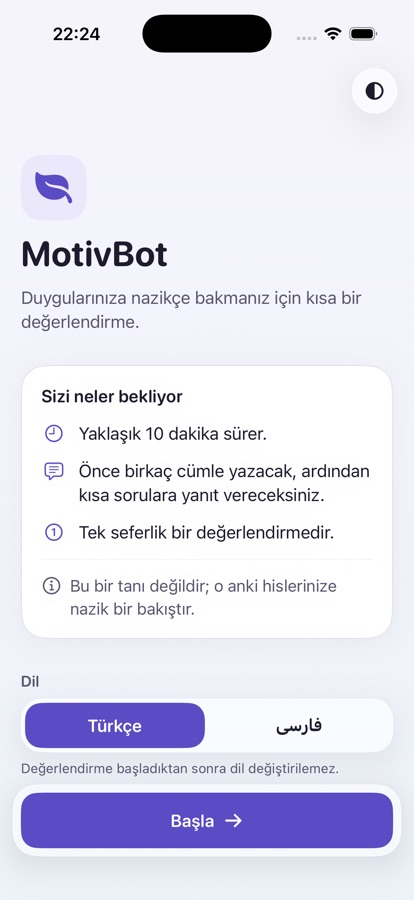
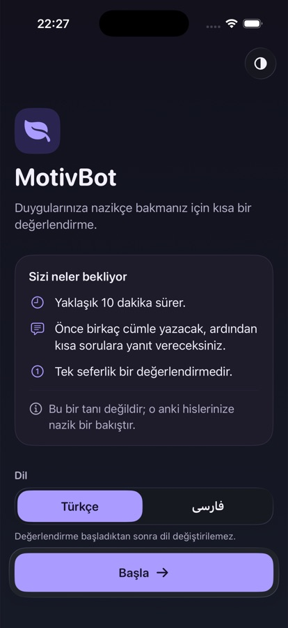
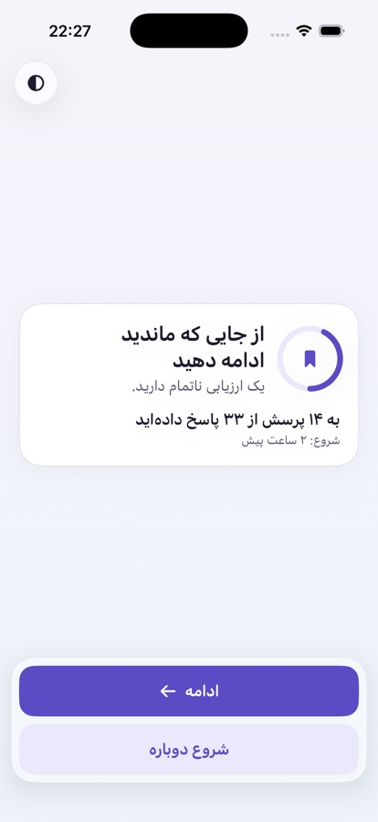
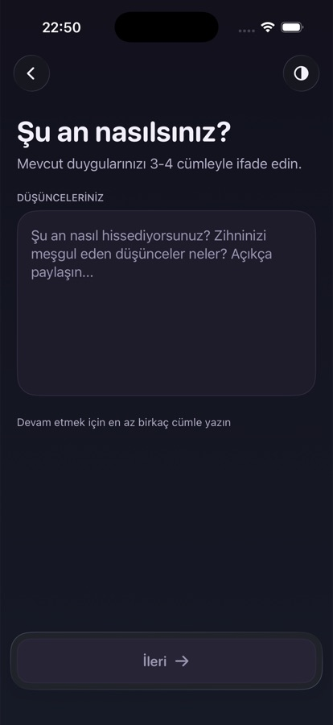
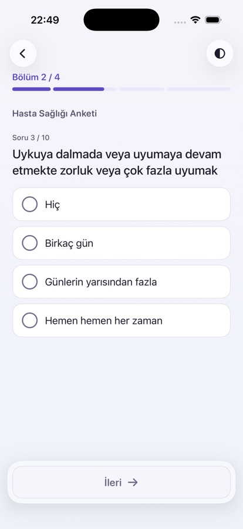
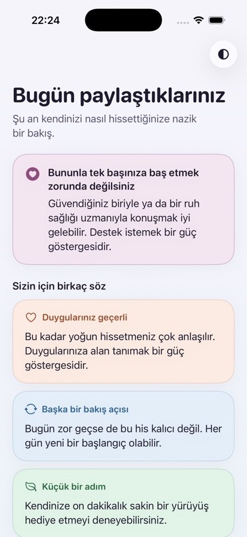
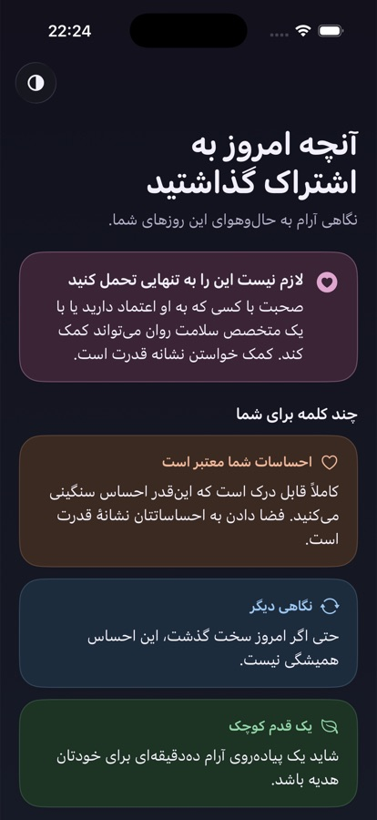
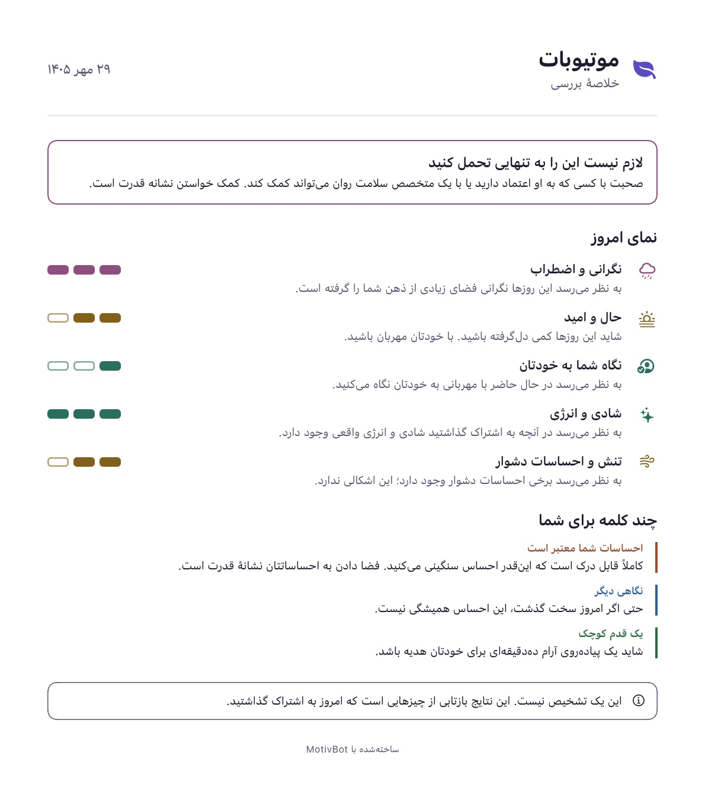
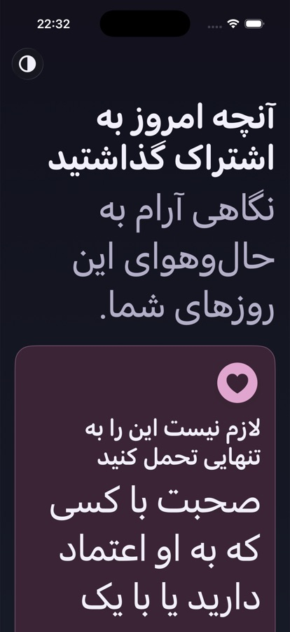

# MotivBot iOS design system

This document covers the design system and screens of the iOS client (`MotivBot/`). It is written for the
iOS integration agent, the backend agents and anyone reviewing the app. The Android app (`MotivBot_final/`)
is not covered.

Code lives in `MotivBot/DesignSystem/`. Colours live in `MotivBot/Assets.xcassets/DesignSystem/`.

## Principles

- **Calm and trustworthy.** Soft lavender and blue backgrounds, one brand purple, and warm tones for results.
  There is no red and no error styling: problems are explained calmly in a notice banner.
- **Turkish and Persian only.** There is no English in the UI. Persian is right to left, uses Persian digits and
  the Solar Hijri calendar, and uses the system font (SF Arabic).
- **No emoji, no privacy claims, no institutional branding.**
- **One-time survey.** There is no history, no streaks, no accounts, no social features and no gamification.
- **Native iOS 26.** The design uses Liquid Glass only for floating controls (icon buttons and the bottom action bar).
  Content stays on solid cards so text keeps its contrast.

## Tokens

### Colours

Every colour is an asset catalog colour with a light and a dark variant. Xcode generates Swift symbols for them
(`Color.dsBrand`, `.foregroundStyle(.dsBrand)`). Do not use inline colours in screens.

| Token | Light | Dark | Use |
|---|---|---|---|
| `dsBackgroundTop` / `dsBackgroundBottom` | `#F6F4FB` / `#EEF3FA` | `#12111C` / `#161A26` | Screen gradient (`AppBackground`) |
| `dsSurface` | `#FFFFFF` | `#1E1C2B` | Cards |
| `dsSurfaceMuted` | `#F7F5FC` | `#262435` | Text fields, the Reduce Transparency fallback |
| `dsStroke` | `#E4E0EF` | `#2E2B40` | Card borders, dividers |
| `dsTextPrimary` | `#1F1B2E` | `#F2F0FA` | Body text, titles |
| `dsTextSecondary` | `#5A5570` | `#B4AFC8` | Supporting text |
| `dsTextTertiary` | `#6E6985` | `#9A95B0` | Disabled labels, hints |
| `dsBrand` / `dsBrandSoft` | `#5B4BC4` / `#ECE8FB` | `#A99BFF` / `#2A2550` | Primary action, selection |
| `dsOnBrand` | `#FFFFFF` | `#17142B` | Text on `dsBrand` |
| `dsSteady` / `dsSteadySoft` | `#2A6F5E` / `#E3F2EC` | `#7FD1B9` / `#1C3530` | Results tone: doing well |
| `dsGentle` / `dsGentleSoft` | `#83601A` / `#F7EDD3` | `#E3C27A` / `#3A3020` | Results tone: worth noticing; notice banner |
| `dsCare` / `dsCareSoft` | `#8E4F7E` / `#F4E6F0` | `#E0A6CF` / `#3A2435` | Results tone: needs care; support card |
| `dsPeach` / `dsPeachSoft` | `#9A4F2E` / `#FCEBE2` | `#F0B89A` / `#3B2A22` | Message category: validation |
| `dsSky` / `dsSkySoft` | `#2D6194` / `#E3EEF9` | `#9CC8F2` / `#1D2C3D` | Message category: reframing; info banner |
| `dsMint` / `dsMintSoft` | `#2D6B43` / `#E2F3E8` | `#92D6A8` / `#1D3324` | Message category: action |

#### Contrast (WCAG 2.1, measured with a script)

Each accent is measured on its own soft colour and on `dsSurface`. Every pair passes AA for normal text (4.5:1).

| Accent | Light: on soft / on surface | Dark: on soft / on surface |
|---|---|---|
| steady | 5.14 / 5.94 | 7.32 / 9.33 |
| gentle | 4.93 / 5.75 | 7.55 / 9.76 |
| care | 4.88 / 5.88 | 7.09 / 8.38 |
| peach | 5.13 / 5.95 | 7.81 / 9.57 |
| sky | 5.50 / 6.46 | 8.08 / 9.52 |
| mint | 5.53 / 6.37 | 8.00 / 9.88 |
| brand | 5.39 / 6.46 | 5.96 / 7.02 |
| text tertiary (on muted / on surface) | 4.79 / 5.22 | 6.50 / 5.81 |
| text primary on careSoft | 13.89 | 12.55 |
| text secondary on careSoft | 5.87 | 6.68 |
| text secondary on brandSoft | 5.90 | 6.70 |

### Typography (`DSFont`)

All styles are built on system text styles, so they scale with Dynamic Type. Titles use the rounded design.
Body text uses the default design, which reads better in long Turkish and Persian passages.

| Token | Base style | Use |
|---|---|---|
| `display` | largeTitle, rounded, bold | Screen titles |
| `title` | title2, rounded, semibold | Card titles, section intro |
| `heading` | headline, rounded, semibold | Section headings, buttons |
| `question` | title3, medium | Question text |
| `body` / `bodyEmphasis` | body / body semibold | Paragraphs, answers |
| `callout`, `footnote` | callout, footnote | Supporting text |
| `caption` | caption, medium | Small labels |
| `label` | subheadline, rounded, semibold | Progress labels, category names |

Two text modifiers:

- `.dsBodyText()`: line spacing of 5 pt in RTL and 3 pt otherwise (Persian script needs more room). It also wraps
  instead of truncating.
- `.dsTitleText()`: titles stop growing at accessibility size 2. Up to 4 lines are allowed, and the text shrinks
  to as little as 50% so long Turkish words such as "paylaştıklarınız" do not break in the middle.

### Spacing, radii, sizes and motion

- `DSSpacing`: 4 pt scale. `xxs` 4, `xs` 8, `s` 12, `m` 16, `l` 24, `xl` 32, `xxl` 48. `screen` is 20, the
  horizontal margin of every screen.
- `DSRadius`: `small` 12, `medium` 16, `large` 24. All corners are continuous.
- `DSSize`:
  - `minTap` 44, the smallest tap target allowed
  - `answerOptionMinHeight` 56
  - `buttonMinHeight` 54
  - `contentMaxWidth` 560, which keeps line length readable on iPad
- `DSMotion`:
  - `quick` 0.2 s ease out
  - `standard` 0.35 s ease in-out
  - `gentle` 0.5 s ease out
  - `soft` spring (response 0.45, damping 0.85)
  - `autoAdvanceDelay` 380 ms
  - `DSMotion.animation(_:reduceMotion:)` turns any movement into a 0.2 s cross-fade when Reduce Motion is on.

## Components

| Component | File | Notes |
|---|---|---|
| `AppBackground` | `DSSurfaces.swift` | Static two-colour gradient. No animated blobs. |
| `.dsCard(fill:stroke:padding:)` | `DSSurfaces.swift` | Solid card, radius 24, hairline stroke, soft shadow. |
| `.dsGlass(in:interactive:)` | `DSSurfaces.swift` | `glassEffect`. With Reduce Transparency it becomes an opaque muted surface with a stroke. |
| `.dsAppear(delay:)` | `DSSurfaces.swift` | Fade in and rise by 14 pt, staggered per section. Reduce Motion: fade only. |
| `DSPrimaryButtonStyle`, `DSSecondaryButtonStyle`, `DSTertiaryButtonStyle` | `DSButtons.swift` | Full-width, at least 54 pt tall. Shrinks to 0.97 when pressed (not with Reduce Motion). Disabled buttons look muted but keep readable text. |
| `GlassIconButton` | `DSButtons.swift` | 44 pt glass circle. The icon stops growing at xxxLarge, and the Large Content Viewer shows it at accessibility sizes. |
| `AnswerOptionRow`, `SelectionIndicator` | `DSSelection.swift` | Single-choice row, at least 56 pt tall. The radio animates into a check. Has the `.isSelected` trait. |
| `SelectableChip`, `ChipGroup` | `DSSelection.swift` | Grid answers and reflection feelings. Chips stack vertically at accessibility sizes. |
| `SegmentedProgressBar` | `DSProgress.swift` | One segment per section, with width weighted by question count. Mirrors in RTL. VoiceOver reads it as a single value. |
| `ProgressRing` | `DSProgress.swift` | Resume prompt. Mirrors in RTL. |
| `LevelIndicator` | `DSProgress.swift` | 3 steps (filled or outlined) instead of percentages. Readable in black and white. |
| `MessageCard` | `DSResultComponents.swift` | Tinted by `MessageCategoryStyle` (validation, reframing, action, other). |
| `MessageDeck` | `DSResultComponents.swift` | The messages as a card stack. Swipe right = liked, left = not liked; the directions stay physical in Persian. Like / dislike buttons and VoiceOver actions do the same. Reduce Motion: the card fades out instead of flying off. |
| `Banner` | `DSResultComponents.swift` | `info` (sky) and `notice` (honey) only. There is no error style on purpose. |
| `ThemeToggle` | `DSControls.swift` | Follows the system by default. A tap switches to the opposite of the system appearance, the next tap back to the system. Stored in `@AppStorage("themePreference")`, applied in `MindWellApp`. |
| `LanguagePicker` | `DSControls.swift` | Each language is written in its own script. Disabled when the language is locked. |
| `TopBar`, `BottomActionBar`, `ScreenColumn` | `DSControls.swift` | Screen chrome. The bottom bar is a floating glass panel. |
| `ResultSummaryPage`, `ResultExporter`, `ExportShareSheet` | `Export/` | One-page PDF or PNG summary (see Results). |

`DSTheme.swift` adds `AppLanguage.locale` (`tr_TR`, `fa_IR`) and `AppLanguage.calendar` (Persian or Gregorian). It
also adds `LocalizationManager` helpers:

- `localizedString(_:_:)`: format arguments with the current locale, so Persian gets Persian digits
- `number(_:)`
- `longDate(_:)`: for example "۲۹ مهر ۱۴۰۵"

`PreviewFixtures.swift` (DEBUG only) has an in-memory session store, a fake prediction service and `PreviewHost`.
`PreviewHost` puts the real view model in a given state (fresh, resumable, questionnaire, loading, result,
completed) and language. Every screen has light, dark and Persian (RTL) previews.

## Screens

The screen is chosen in `ContentView`:

1. **Resume prompt**, when `resumableSession != nil`.
2. **Welcome**, when the view model is on the emotion input screen and the user has not tapped Start yet.
3. Otherwise, `currentScreen`.

Screen changes fade and move 16 pt (fade only with Reduce Motion).

### Welcome (new)

 

The welcome screen shows:

- the leaf mark, the app name and a one-line tagline
- a "What to expect" card: about 10 minutes, the two steps, one-time only, and "not a diagnosis"
- the language picker, which is the only place the language can be changed, with a note that the language locks
  once the assessment starts
- Start in the bottom action bar

### Resume prompt (new)

The resume prompt shows a progress ring, "Continue where you left off", the number of answers ("به ۱۴ پرسش از ۳۳
پاسخ داده‌اید") and when the session started, as a relative date in the session's locale. It is always shown in
the saved session's language.

- **Continue** resumes the session.
- **Start over** asks for confirmation in a dialog ("your answers will be deleted"), then calls `startOver()`.

### Emotion input

This screen has a title, the prompt and a large text editor card. The card's stroke turns brand purple while it
has focus. Below the card, a hint line changes with the text:

- the "write a few sentences" hint
- a green "ready to continue" line
- a calm notice banner for text in the wrong language or text that is too long (it shows the limit)

The back button only appears while the language can still change.

### Questionnaire

- **Header:** a back button, "Section 2 / 4", and the segmented progress bar. After each answer, a short
  "Progress saved" note fades in under the bar.
- **Section intro:** the full title and description on the first question of a section, and the title only after that.
- **Question:** "Question 3 / 10", the question text, an optional image, then the answer control:
  - single choice: answer rows. Choosing one moves on after 380 ms, except on the last question.
  - scale: a large value, ± buttons and a slider
  - free text: marked "Optional"
  - number: a number pad. An age under 18 shows a gentle note that the assessment is for adults; it does not block.
  - grid sections: chips
- **Navigation:** going back restores the earlier answer. The swipe direction follows the layout direction.
- **Motion and haptics:** questions slide in the direction of travel (fade only with Reduce Motion). There is
  a selection haptic on every answer and a light impact when a new section starts.
- The questions, options and scoring are unchanged.

### Loading

The loading screen has two soft breathing circles around the leaf mark. They animate on a 4 s loop and stay still
with Reduce Motion. The title and subtitle change with `analysisPhase`:

- **Connecting / analysing:** the title and subtitle for that phase.
- **Waking up:** an info banner explains that the service has been idle and may take about a minute.
- **Tips:** they rotate every 6 s and are hidden from VoiceOver.
- **Failed:** a cloud icon, "Let's take a short pause", the error message in a notice banner, and Retry in the
  bottom bar.

VoiceOver announces each phase change. There is no screenshot, because reaching this screen sends a real request
to the analysis service.

### Results

 

The screenshots predate the message deck and still show the support card and today's view.

The results screen has these parts, in this order:

1. Header: "What you shared today" and a short subtitle.
2. **Messages**: up to three cards ordered validation, reframing, action, shown one at a time as a `MessageDeck`.
   Swiping right means the message was liked, left that it was not. The feedback is kept in
   `viewModel.messageFeedback` and written to the CSV. When every card is rated a thank-you card offers to show them
   again.
3. Disclaimer: this is not a diagnosis.
4. **Export**: PDF and Image buttons. The existing CSV share button is unchanged and only appears when
   `csvFileURL` is set.
5. **Reflection**: feeling chips (text only, no emoji), an optional note, and Submit. A feeling is required: Submit
   stays disabled until one is chosen.
6. **Completion** (after Submit): a leaf that bounces once, a thank-you message, and Restart. Restart also deletes
   exported files.

The support box and the five dimensions are no longer on the screen; they are only in the PDF / image summary.

There is a success haptic when the results appear.

#### Export

`ResultExporter` renders `ResultSummaryPage` with `ImageRenderer`. The page has:

- the app name and "Assessment summary"
- the date in the summary's language and calendar ("۲۹ مهر ۱۴۰۵")
- the support box, only when the risk is elevated
- the five dimensions with their level steps and sentences
- the messages, each with a thin category bar
- the boxed disclaimer and a footer

It never includes the free text or any individual answer.

How the export works:

- The page is always light, on a white background, at a fixed text size (`.large`). Levels show as filled and
  outlined steps, so the page reads in black and white.
- The PDF is one A4 page (595 × 842 pt). Longer content is scaled down to fit and pinned to the top.
- The PNG is rendered at 2x and is opaque.
- Files are written to `tmp/ResultExport/` with complete file protection. They are deleted when the share sheet
  closes, on restart, before each new export, and at app launch (in case the app was closed with the sheet open).

Both formats were checked in Persian on the Simulator: the page renders correctly, mirrors for RTL, and shows the
Persian date and digits.

## Accessibility checks run

| Check | How | Result |
|---|---|---|
| Colour contrast | Script over every token pair in light and dark (table above) | Every text pair is at least 4.5:1 |
| Dynamic Type | Simulator at `accessibility-extra-extra-extra-large` (AX5), Welcome and Results in tr and fa | Text wraps and scrolls with no clipping. Two issues found and fixed: titles broke long Turkish words in the middle, and icon buttons grew past their circle. Accessibility layouts are used by `ChipGroup` and `LanguagePicker` |
| RTL | Simulator in fa, light and dark; Persian previews for every screen | Layout, progress bar, ring, chevrons, swipe-back and the export page all mirror |
| Tap targets | Code review of every control | Icon buttons 44 pt, answer rows 56 pt, buttons 54 pt, chips 44 pt |
| Reduce Motion | Code review | Every transition and appear animation uses `DSMotion.animation(_:reduceMotion:)` or a fade-only path. The breathing circles stay still |
| Reduce Transparency | Code review | `.dsGlass` becomes an opaque surface with a stroke |
| VoiceOver | Code review of labels, traits and grouping | Headings have `.isHeader`; selection rows have `.isSelected`; decorative icons are hidden; dimension and message cards are combined into one element; loading phases are announced; the rotating tips are hidden |
| Build warnings | `xcodebuild` Debug and Release | 0 warnings (the only notice is the AppIntents metadata line, which was there before) |
| Unit tests | `MotivBotTests` | Pass |

Not done yet: a full VoiceOver pass on a device, and Accessibility Inspector audits. Both are recommended before
release.

## Requests for the integration agent

The view layer works around these today. Moving them into the view model or `docs/ios-state-contract.md` would make
the behaviour testable and keep logic out of views.

1. **Welcome state.** Add a `.welcome` screen case, or `hasStarted` plus `startAssessment()`. Today `ContentView`
   keeps `hasStarted` in view state.
2. **Theme.** `ThemePreference` (system, light, dark) replaces `isDarkMode` and `toggleTheme()`, which are now
   unused and can be removed.
3. **Saved indicator.** Add `lastSavedAt: Date?`, set when a save actually succeeds. The "Progress saved" note is
   currently timed after each answer, not tied to the save.
4. **Restoring answers on back.** `previousQuestion()` clears the selection. The view takes a snapshot of the
   answers and restores `selectedOptionId`, `scaleValue`, `freeTextAnswer` or `gridAnswers`. This belongs in the
   view model.
5. **Typed message category.** `MessageCategoryStyle` maps the English category strings from the pipeline. An enum
   from the service layer would be safer.
6. **Under-18 check.** The view parses the age field and compares it with `PredictionRequestBuilder.ageRange`. An
   `ageWarningKey` property would be cleaner.
7. **Locale.** `AppLanguage.locale` and `.calendar` live in `DSTheme.swift`. They could move next to `AppLanguage`.
8. **Resumable session details.** The current section index in `ResumableSession` would let the prompt say where
   the user stopped.
9. **Preview support.** `PreviewFixtures.swift` uses only the public initialiser and `SessionStoring`. If the store
   format changes, the fixtures need the same change.
10. **Export clean-up.** Exported files are deleted by the view layer (restart and launch). If restart moves fully
    into the view model, call `ResultExporter.removeFiles()` there.

## Pending suggestions (not built, need approval)

- A confirmation before Restart on the completion screen.
- An optional breathing cue on the loading screen.
- A "Need to talk now?" sheet with crisis resources, linked from the support card. This needs vetted local resources
  for Turkey and Iran; the `support_resources_body` placeholder string is not shown.

## Notes

- Questions, options and scoring are unchanged. The `qa_5` question is untouched.
- The CSV share is unchanged and left to the backend agents.
- Reflection storage will be added later. The UI makes no claims about it.
- All new strings are in `tr.lproj` and `fa.lproj/Localizable.strings`, under `/* MARK: design */`. Both files pass
  `plutil -lint` and have the same keys.
